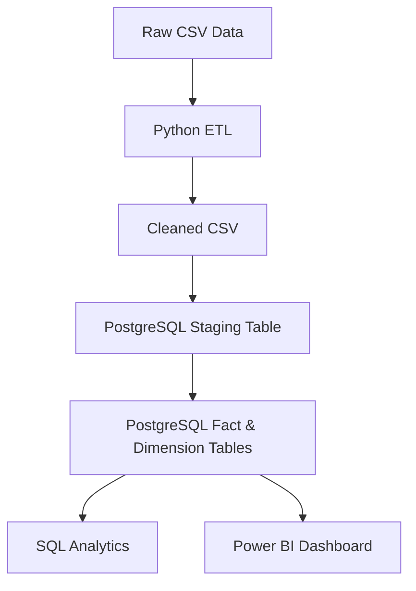
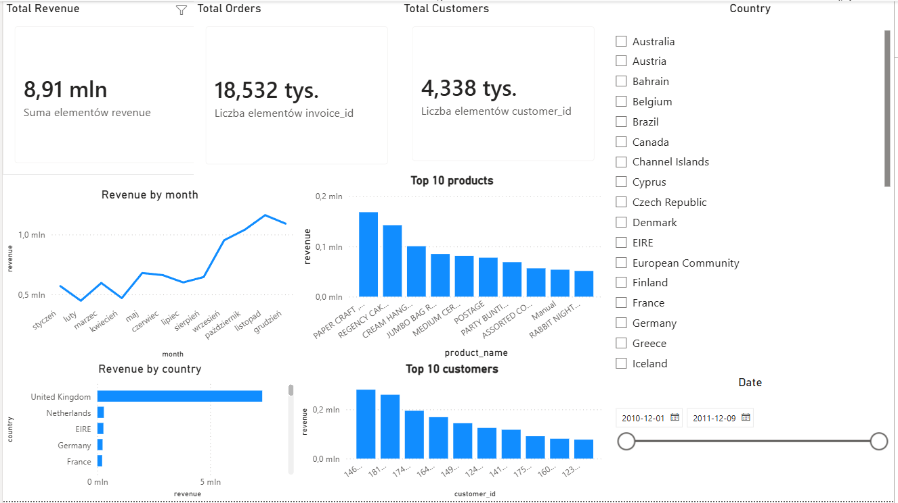

# E-commerce Data Pipeline

## Project Description

This project presents a simple end-to-end data pipeline built on an e-commerce dataset. The data is explored and cleaned using Python and Pandas, loaded into PostgreSQL, transformed into a star schema, analyzed with SQL, and visualized in Power BI.

The pipeline stages are currently executed separately rather than through an automated scheduler.

## Project Architecture



## Tech Stack

- Python (Pandas)
- PostgreSQL
- SQL
- SQLAlchemy
- psycopg2
- python-dotenv
- Power BI
- Git & GitHub

## ETL Process

The Python scripts perform data exploration and cleaning before loading the cleaned dataset into PostgreSQL.

Steps:

1. Explore the raw dataset using `explore_data.py`.
2. Clean and transform the data using `clean_data.py`:
   - Remove rows with missing customer IDs.
   - Remove non-positive quantities.
   - Remove products with non-positive prices.
   - Convert invoice dates to datetime format.
   - Save the cleaned dataset as a CSV file.
3. Load the cleaned data into PostgreSQL using `load_to_postgres.py`.
4. Create fact and dimension tables using SQL scripts.

Transactions with non-positive quantities or prices are excluded from the analysis. Therefore, the resulting revenue calculations do not account for returns and cancellations.

## Data Model

The database uses a simple star schema built from the `clean_retail` staging table.

**Fact table:**

- `fact_sales`

**Dimension tables:**

- `dim_customers`
- `dim_products`

## SQL Analysis

Example analyses include:

- Total revenue
- Monthly revenue trend
- Top customers
- Top products
- Revenue by invoice
- Orders per customer

SQL queries are stored in `sql/analytics_queries.sql`.

## Power BI Dashboard

The dashboard includes:

- Total Revenue
- Total Orders
- Total Customers
- Revenue by Month
- Revenue by Country
- Top 10 Products
- Top 10 Customers
- Country and Date filters



## Setup and Run

### Prerequisites

Before running the project, make sure you have installed:

- Python 3.12
- PostgreSQL
- Git
- Power BI Desktop (optional)

### 1. Clone the repository

```bash
git clone https://github.com/MatexV2/ecommerce_data_pipeline.git

cd ecommerce_data_pipeline
```

### 2. Install dependencies

Install the required Python libraries using:

```bash
python -m pip install -r requirements.txt
```

### 3. Configure PostgreSQL

Create a PostgreSQL database named `ecommerce`.

Copy the `.env.example` file and rename the copy to `.env`.

Update the configuration with your local database credentials:

```dotenv
DB_HOST=localhost
DB_PORT=5432
DB_NAME=ecommerce
DB_USER=postgres
DB_PASSWORD=your_password_here
```

Database credentials are loaded using `python-dotenv` and passed to SQLAlchemy through environment variables.

The `.env` file is excluded from version control using `.gitignore`.

**Never commit passwords or sensitive credentials to GitHub.**

### 4. Prepare the dataset

Place the source CSV file in:

```text
data/raw/online_retail.csv
```

The `data/raw/` and `data/processed/` directories are excluded from Git tracking.

Create these directories locally if they do not exist.

### 5. Run data exploration

```bash
python src/explore_data.py
```

This script provides basic information about the dataset, including:

- Dataset dimensions
- Column data types
- Missing values
- Descriptive statistics
- Unique customers and invoices

### 6. Clean the dataset

```bash
python src/clean_data.py
```

The cleaned dataset is saved to:

```text
data/processed/cleaned_online_retail.csv
```

### 7. Load data into PostgreSQL

```bash
python src/load_to_postgres.py
```

The script:

- Loads database credentials from `.env`.
- Creates a SQLAlchemy database engine.
- Reads the cleaned CSV file using Pandas.
- Loads the data into the `clean_retail` table in PostgreSQL.

The script uses:

```python
if_exists="replace"
```

This means that the existing staging table is recreated when the loading script runs again.

### 8. Create the star schema

Run the SQL scripts in PostgreSQL in the following order:

1. `sql/dim_customers.sql`
2. `sql/dim_products.sql`
3. `sql/fact_sales.sql`

These scripts create the dimension and fact tables used for analytical queries.

The table creation scripts currently require manual execution. Existing tables may need to be handled before running the scripts again.

### 9. Run SQL analytics

Execute:

```text
sql/analytics_queries.sql
```

The queries provide insights into revenue, customer activity, product performance, and sales trends.

### 10. Power BI Dashboard

The processed database tables are used as the data source for the Power BI dashboard.

The dashboard provides an interactive overview of sales performance, customer behavior, and product revenue.

A screenshot is available in:

```text
docs/BI-1.PNG
```

## Repository Structure

```text
ecommerce_data_pipeline/
│
├── data/
│   ├── raw/
│   │   └── online_retail.csv
│   └── processed/
│       └── cleaned_online_retail.csv
│
├── docs/
│   └── BI-1.PNG
│
├── sql/
│   ├── analytics_queries.sql
│   ├── dim_customers.sql
│   ├── dim_products.sql
│   └── fact_sales.sql
│
├── src/
│   ├── explore_data.py
│   ├── clean_data.py
│   └── load_to_postgres.py
│
├── .env
├── .env.example
├── .gitignore
├── requirements.txt
└── README.md
```

**Note:** The `.env` file and CSV datasets are stored locally and are not included in the public GitHub repository.

## Current Limitations

- ETL scripts are executed manually.
- Automated data quality tests are not yet implemented.
- SQL table creation scripts are not fully idempotent.
- Incremental data loading is not implemented.

These are potential areas for future development.
